## Apartado 1 ##

### Preparación del sistema ###

Se actualiza primero la lista de paquetes y el sistema:
```bash
sudo apt update
sudo apt upgrade -y
```
Despues se comprueba la version del sistema:
```bash
lsb_release -a
```
*Captura versión de Ubuntu :*

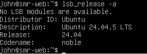

---


## Apartado 2 ##

### Instalación de Apache ###

Ahora se instala Apache:
```bash
sudo apt install apache2 -y
```
Y se comprueba la versión que se ha instalado:
```bash
apache2 -v
```
 #### Pregunta 1: ####
 *¿Qué paquetes adicionales se han instalado como dependencias?*
 
 Se instalaron: 
- apache2-bin
- apache2-data
- apache2-utils
- libapr1
- libaprutil1
- ssl-cert
- mime-support


---

## Apartado 3 ##

### Comprobación del funcionamiento ###

#### 3.1. Se mira el estado del servicio: ####
```bash
sudo systemctl status apache2
```
#### 3.2. Luego los puertos en escucha: ####
```bash
sudo ss -tulpn | grep apache2
```
#### 3.3. Se prueba desde el terminal y desde el navegador: ####
```bash
curl -I http://localhost
```

*Capturas del estado del servicio y de la página por defecto en el navegador:*

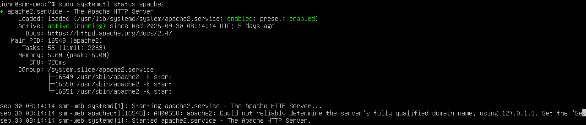

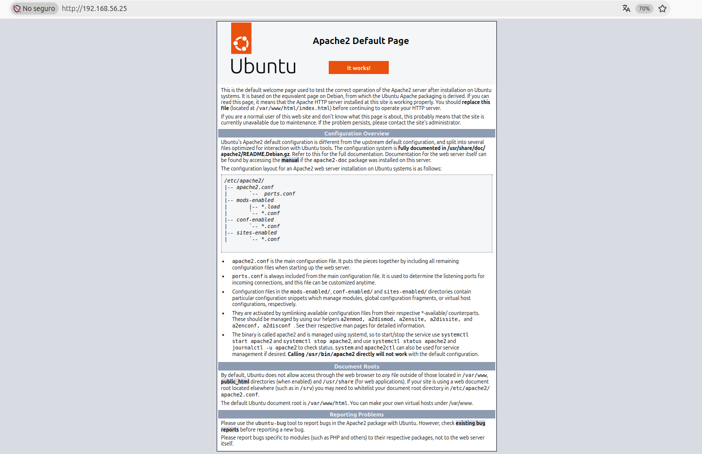

#### 3.4. Firewall: ####
```bash
sudo ufw status
sudo ufw allow 'Apache'
```
**Pregunta 2:**

*¿Qué diferencia hay entre los perfiles Apache, Apache Full y Apache Secure?¿Qué diferencia hay entre los perfiles Apache, Apache Full y Apache Secure?*

- **Apache:** Se usa para conexiones HTTP y los datos que viajan no estan protegidos, solo abre el puerto 80.
- **Apache Secure:** Se usa para conexiones seguras HTTPS y los datos que viajan estan protegidos y cifrados, solo abre el puerto 443.
- **Apache Full:** Es la que mas se usa, porque la gente puede entrar de la forma que quieran y el servidor los llevara a la opcion segura, abre el puerto 80 y el 443.

---

## Apartado 4 ##

### Comandos principales de administración ###

Estos son los principales comandos y sus explicaciones:

| Comando | Funcion |
|-----|----|
| sudo systemctl start apache2 | Inicia el servicio |
| sudo systemctl stop apache2 |  Detiene el servicio |
| sudo systemctl restart apache2 | Reinicia (corta conexiones) |
| sudo systemctl reload apache2 | Recarga la configuración sin cortar conexiones |
| sudo systemctl enable apache2 | Arranque automático al iniciar el sistema |
| sudo systemctl disable apache2 | Desactiva el arranque automático |
| apache2ctl configtest | Comprueba la sintaxis de la configuración |
| apache2ctl -S | Muestra los sitios (virtual hosts) cargados |
| apache2ctl -M | Lista los módulos cargados |
| a2enmod / a2dismod | Activa / desactiva módulos |
| a2ensite / a2dissite | Activa / desactiva sitios |
| a2enconf / a2disconf | Activa / desactiva fragmentos de configuración |

**Pregunta 3:**

*¿Cuando conviene usar reload en lugar de restart?*

Cuando por ejemplo se necesita reiniciar pero hay que mantener las conexiones activas.

---

## Apartado 5 ##

### Ficheros y directorios importantes ###

Para ver la estructura de configuracion:
```bash
ls -l /etc/apache2/
```

Estas son las distintas rutas y la descripcion de lo que son:

| Ruta | Descripcion |
|-----|------|
| /etc/apache2/apache2.conf | Fichero de configuración principal |
| /etc/apache2/ports.conf | Puertos en los que escucha Apache |
| /etc/apache2/sites-available/ | Sitios disponibles (definidos, no necesariamente activos) |
| /etc/apache2/sites-enabled/ | Sitios activos (enlaces simbólicos a sites-available) |
| /etc/apache2/mods-available/ y mods-enabled/ | Módulos disponibles y activos |
| /etc/apache2/conf-available/ y conf-enabled/ | Fragmentos de configuración disponibles y activos |
| /etc/apache2/envvars | Variables de entorno (usuario y grupo de ejecución, etc.) |
| /var/www/html/ | Directorio raíz por defecto (DocumentRoot) |
| /var/log/apache2/access.log | Registro de accesos |
| /var/log/apache2/error.log | Registro de errores |

Los ficheros de sites-enabled son enlaces simbolicos y se pueden comprobar con este comando:
```bash
ls -l /etc/apache2/sites-enabled/
```

*Captura del contenido de /etc/apache2/ :*

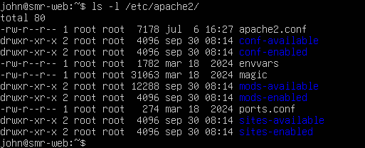

**Pregunta 3:**

*¿Por qué Apache usa enlaces simbólicos entre los directorios que terminan en las palabras -available y -enabled?*

Usa enlaces simbolicos para evitar que hayan errores, para tenerlo todo bien estructurado y ordenador, y por comodidad 

---

## Apartado 6 ##

### Modificaciones tipicas del servicio ###

Hay que hacer siempre una copia de seguridad antes de modificar un fichero:
```bash
sudo cp /etc/apache2/apache2.conf /etc/apache2/apache2.conf.bak
```

*Captura del comando:*

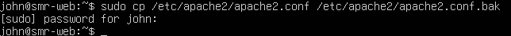

**Pregunta 4:**

*¿qué contenido tiene el fichero? Explícalo con tus palabras*

Tiene la configuracion importante del servidor web de Apache.


*Captura del contenido del fichero:*

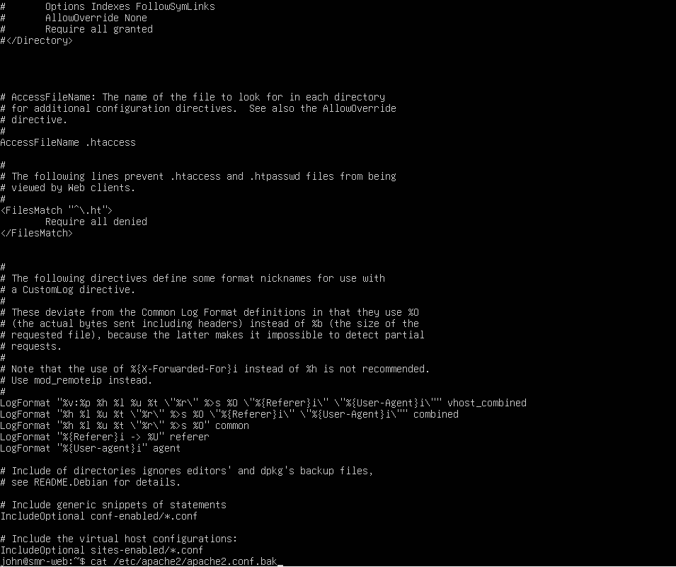

#### 6.1. Cambiar la página de inicio: ####
```bash
echo "<h1>Servidor de TU NOMBRE</h1>" | sudo tee /var/www/html/index.html
```

*Captura del comando hecho:*

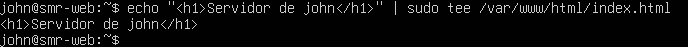


**Pregunta 5:**

*¿Qué hace esta orden?*

Cambia lo que aparece en la pagina web, entonces aparecera un texto en el que pone **Servidor de john**.


*Captura de como aparece en la pagina web:*

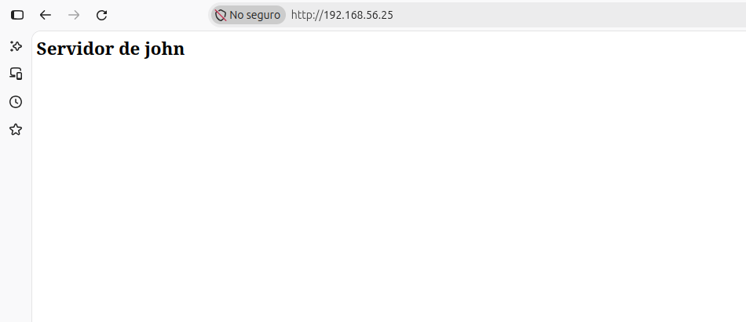

#### 6.2. Cambiar el puerto de escucha *(por ejemplo, al 8080)*: ####
Para cambiar el puerto hay que editar /etc/apache2/ports.conf y el VirtualHost de 000-default.conf, hay que cambiar Listen 80 por Listen 8080 y <VirtualHost *:80> por <VirtualHost *:8080>.:
```bash
sudo nano /etc/apache2/ports.conf
sudo nano /etc/apache2/sites-available/000-default.conf
```

*Capturas de los puertos cambiados en cada fichero:*

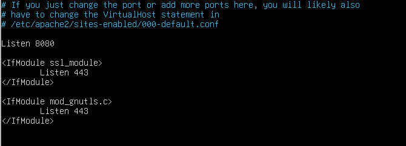

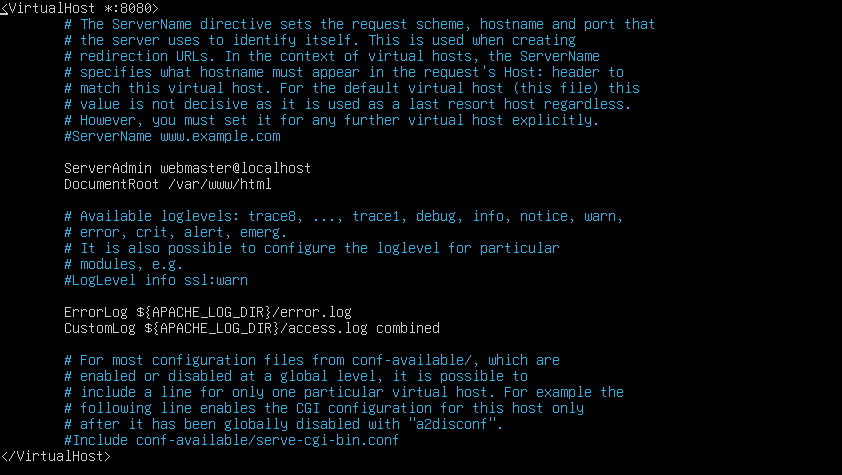


Después :
```bash
sudo apache2ctl configtest
sudo systemctl reload apache2
curl -I http://localhost:8080
```
Y cuando se termina se puede dejar de nuevo en el puerto 80.


*Captura de los tres comandos:*

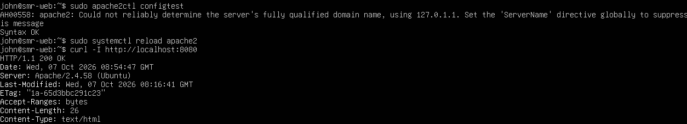


#### 6.3. Definir el nombre del servidor *(hay que eliminar el aviso "Could not reliably determine the server's fully qualified domain name")*: ####
```bash
echo "ServerName localhost" | sudo tee /etc/apache2/conf-available/servername.conf
sudo a2enconf servername
sudo systemctl reload apache2
```

*Captura de los comandos usandolos para eliminar el aviso:*

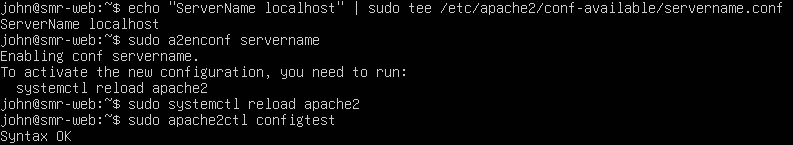

#### 6.4. Cambiar el correo del administrador *(ServerAdmin en el fichero del sitio)*: ####

*Captura del correo cambiado:*

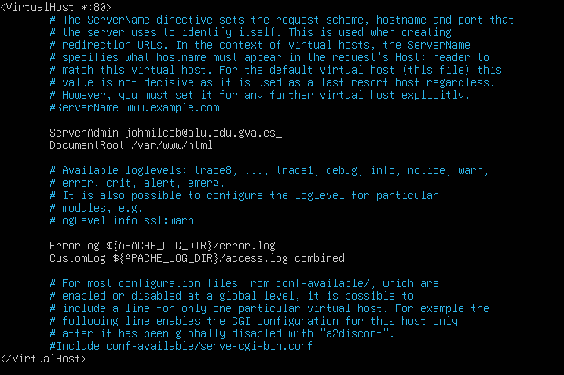


#### 6.5. Personalizar una página de error *(por ejemplo, 404)* con la directiva ErrorDocument: ####

Para hacerlo se crea una pagina en la que ponga un mensaje de error y despues en la configuracion se añade **ErrorDocument 404 /(nombre del archivo de la pagina de error)** y se guardan los cambios, los comando que se usan son:
```bash
sudo nano /var/www/html/error.html
echo "<h1>Error 404: No se ha encontado la practica</h1> | sudo tee /var/www/html/error.html
sudo nano /etc/apache2/sites-available/000-default.conf
sudo apache2ctl configtest
sudo systemctl reload apache2
```

*Capturas del proceso para crear la pagina de error:*


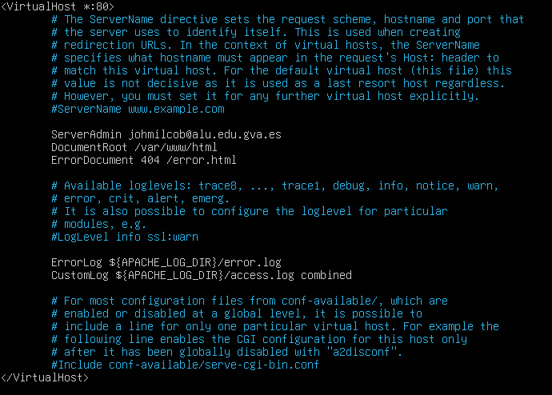


*Captura de la pagina de error:*

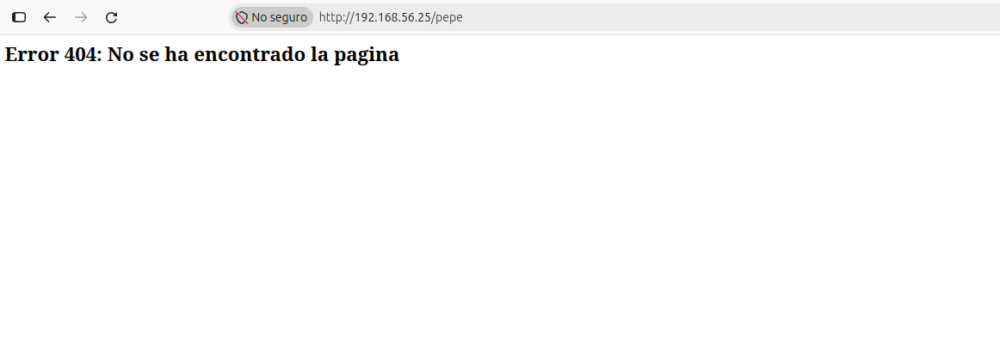

---

## Apartado 7 ##

### Módulos de Apache ###

Apache funciona por módulos que se cargan según la necesidad, se pueden ver con:
```bash
apache2ctl -M
ls /etc/apache2/mods-available/
```

Con estos comandos se activan para comprobar algunos módulos habituales:
```bash
sudo a2enmod rewrite
sudo a2enmod headers
sudo a2enmod ssl
sudo systemctl restart apache2
apache2ctl -M | grep -E "rewrite|headers|ssl"
```

Esta es una tabla con 8 módulos y cada función que tienen:

| Módulo | Función |
|---------|----------|
| mod_rewrite | Reescritura de URL | 
| mod_headers | Manipulación de cabeceras HTTP | 
| mod_ssl | Soporte HTTPS | 
| mod_dir | Gestión de ficheros índice (index.html) | 
| mod_alias | Redirecciones y alias de rutas | 
| mod_auth_basic | Autenticación básica | 
| mod_status | Página de estado del servidor | 
| mod_php / PHP-FPM | Ejecución de PHP (opcional) | 


**Pregunta 6:**

*¿Qué ocurre si desactivas un módulo del que depende otro?*

Mostrara un aviso advirtiendo cuando ejecutas el comando para desactivarlo y si intentas reiniciar fallara el servidor apache, y si pones el comando **sudo apache2ctl configtest** pondra un error diciendo que no reconoce luna directiva o funcion porque no esta el modulo base.

---

## Apartado 8 ##

### Varios sitios en un mismo servidor (Virtual Hosts) ###

Vamos a crear dos sitios: sitio1.local y sitio2.local.

#### 8.1. Comandos para crear los directorios y páginas: ####
```bash
sudo mkdir -p /var/www/sitio1 /var/www/sitio2
echo "<h1>Bienvenido a SITIO 1</h1>" | sudo tee /var/www/sitio1/index.html
echo "<h1>Bienvenido a SITIO 2</h1>" | sudo tee /var/www/sitio2/index.html
```
#### 8.2. Para crear los ficheros de configuración: ####
```bash
sudo nano /etc/apache2/sites-available/sitio1.conf
<VirtualHost *:80>
    ServerName sitio1.local
    ServerAdmin admin@sitio1.local
    DocumentRoot /var/www/sitio1

    <Directory /var/www/sitio1>
        Options -Indexes +FollowSymLinks
        AllowOverride None
        Require all granted
    </Directory>

    ErrorLog ${APACHE_LOG_DIR}/sitio1_error.log
    CustomLog ${APACHE_LOG_DIR}/sitio1_access.log combined
</VirtualHost>
```

Esto se repite para sitio2.conf cambiando los nombres y rutas.

#### 8.3. Activar los sitios y desactivar el de por defecto: ####
```bash
sudo a2ensite sitio1.conf sitio2.conf
sudo a2dissite 000-default.conf
sudo apache2ctl configtest
sudo systemctl reload apache2
apache2ctl -S
```

#### 8.4. Resolución de nombres. Se añade en /etc/hosts (del servidor y, si puedes, del equipo cliente): ####
```bash
127.0.0.1   sitio1.local sitio2.local
```

#### 8.5. Pruebas #### 
```bash
curl http://sitio1.local
curl http://sitio2.local
```

*Capturas de las pruebas de los dos sitios y de la salida de apache2ctl -S:*

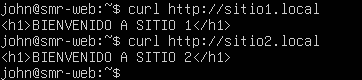
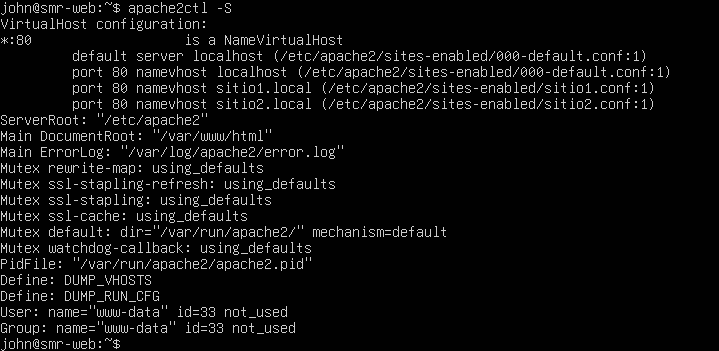

**Pregunta 7:**

*¿Qué diferencia hay entre virtual hosts basados en nombre y basados en IP? ¿Cuál has usado?*

La diferencia es que los basados en nombre tienen solo una IP para todo el servidor y Apache enseña la pagina cuando pones su nombre de dominio, y los basados en IP son una IP por cada pagina y para buscar la pagina hay que poner la IP, en sitio1 y sitio2 he usado basados en nombre porque las paginas tienen las mismas IP y Apache las identifica por el nombre.

---

## Apartado 9 ##

### Permisos y propietarios ###

Apache se ejecuta con el usuario www-data. Se comprueba con:
```bash
ps aux | grep apache2
grep -E "APACHE_RUN_(USER|GROUP)" /etc/apache2/envvars
ls -ld /var/www/sitio1 /var/www/sitio1/index.html
```

Aplicamos una política de permisos razonable:
```bash
sudo chown -R www-data:www-data /var/www/sitio1
sudo find /var/www/sitio1 -type d -exec chmod 755 {} \;
sudo find /var/www/sitio1 -type f -exec chmod 644 {} \;
```

Ahora pruebo qué ocurre al poner chmod 000 a index.html (error 403) y consulto el error.log. Después restaurare los permisos.

*Captura del error 403 y del log:*


Explica en la memoria:
- **Significado 755 y 644:**

- **Por qué nunca se deben usar permisos 777 en un servidor web:**

- **Por qué el contenido web no debe pertenecer a root ni ser escribible por todos:**


