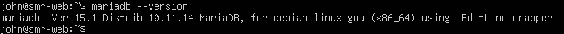
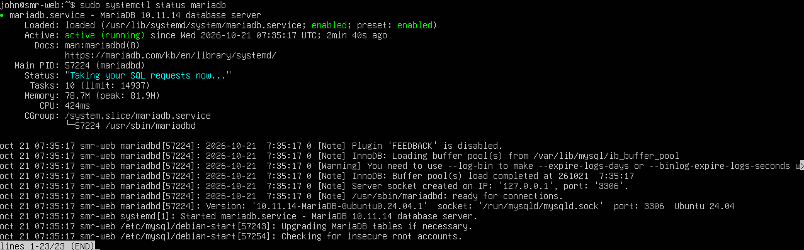
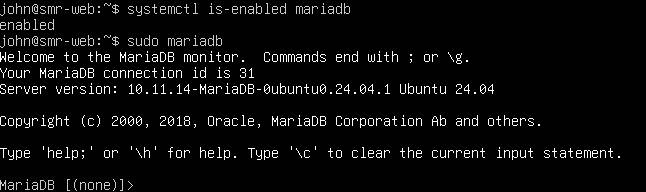
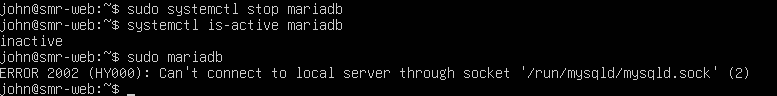
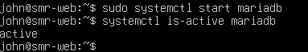
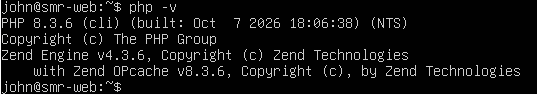
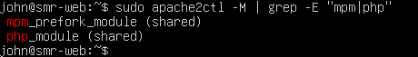
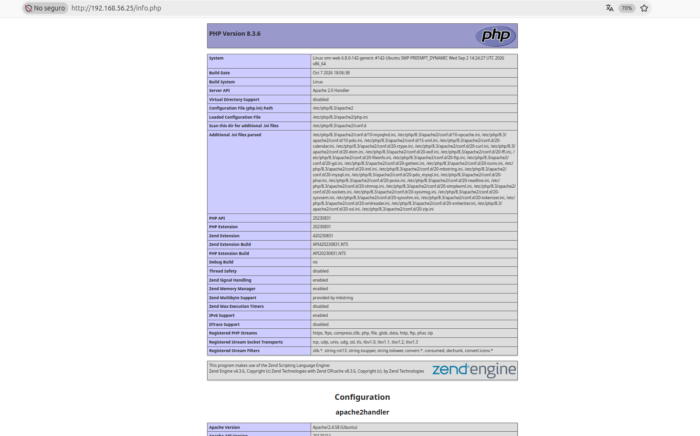

# PRACTICA INSTALACION MARIADB # 
**Aplicaciones web**

### Nombre: ### 
John Eric Millan Cobacho

### Curso: ###
2º SMX

##### Fecha: 22/10/2026 #####

---
---

## Apartado 1 ##

### Preparación del sistema ###

Primero hay que deshabilitar los dos sitios virtuales de la anterior practica y dejamos solo uno:
```bash
sudo a2ensite 000-default.conf
sudo systemctl reload apache2
```

Luego hay que actualizar la lista de paquetes y comprobar que Apache sigue funcionando, en la ultimas linea tiene que poner **active**:
```bash
sudo apt update
sudo apt upgrade -y
systemctl is-active apache2
```
*Captura de la respuesta de **systemctl is-active apache2***:


---

## Apartado 2 ##

### Instalacion de MariaDB ###

Comando para instalar MariaDB:
```bash
sudo apt install mariadb-server -y
```

Ahora se comprueba la version instalada con este comando:
```bash
mariadb --version
```

>Mostrara algo asi:
```bash
mariadb Ver 15.1 Distrib 10.11.14-MariaDB, for debian-linux-gnu (x86_64)
```

*Captura de la version*:



---

## Apartado 3 ##

### Comprobacion del funcionamiento ###

#### 3.1 Estado del servicio ####
El primer comando sirve para ver el estado de MariaDB y tiene que mostrar *active (running)* que significaria que esta funcionando, y el segundo comando mostrara *enabled* que significa que arrancará solo cada vez que el equipo se encienda:
```bash
sudo systemctl status mariadb
systemctl is-enabled mariadb
```

#### 3.2 Entrar en la base de datos ####

Con este comando se entra en la base de datos y mostrara un mensaje de bienvenida si todo va bien, eso indica que todo funciona correcto:
```bash
sudo mariadb
```

>Se vera algo asi:
```bash
Welcome to the MariaDB monitor. Commands end with ; or \g.
Server version: 10.11.14-MariaDB-0ubuntu0.24.04.1 Ubuntu 24.04

MariaDB [(none)]>
```

*Captura del estado de servicio y de la entrada en MariaDB:*




---

## Apartado 4 ##

### Comandos principales ###

Estos comandos se usan para manejar el servicio y su funcion:

| Comando | Funcion |
|-----|------|
| sudo systemctl start mariadb | Arranca el servicio |
| sudo systemctl stop mariadb | Detiene el servicio |
| sudo systemctl restart mariadb | Reinicia el servicio |
| sudo systemctl status mariadb | Muestra su estado |
| sudo systemctl enable mariadb | Lo arranca automáticamente al encender el equipo |

---

## Apartado 5 ##

### ¿Que pasa si MariaDB esta parado? ###

Ahora se va a parar MariaDB y en el estado pondrá inactive, se comprueba que ocurre al intentar entrar en la base de datos: 
```bash
sudo systemctl stop mariadb
systemctl is-active mariadb
sudo mariadb
```

>Aparecerá este error
```bash
ERROR 2002 (HY000): Can't connect to local server through socket '/run/mysqld/mysqld.sock' (2)
```

El error significa que no puede conectar con MariaDB porque no está en marcha, para volver a arrancarlo hay que poner:
```bash
sudo systemctl start mariadb
systemctl is-active mariadb
```

*Captura del error y la recuperación:*




**Pregunta 1:**

*Si WordPress no pudiera conectar con la base de datos, ¿qué dos comandos de este apartado usarías
para saber si el problema es que MariaDB está parado?*

-Usaria los comandos **sudo mariadb** para ver si se puede acceder y **systemctl is-active mariadb** para ver si esta activo o si no lo esta.

---

## Apartado 6 ##

### Instalacion de PHP  ###

Con el primer comando se instala el PHP y las piezas que necesita el WordPress, y con el segundo se puede ver la version:
```bash
sudo apt install php libapache2-mod-php php-mysql php-curl php-gd php-mbstring php-xml php-zip php-intl -y
php -v 
```
Cada paquete sirve para:
| Paquete | Funcion |
|-----|------|
| php | El lenguaje PHP |
| libapache2-mod-php | Permite a Apache ejecutar PHP |
| php-mysql | Permite a PHP hablar con MariaDB (imprescindible) |
| php-curl | Conexiones a otros servidores (actualizaciones, plugins) |
| php-gd | Tratamiento de imágenes |
| php-mbstring | Manejo de textos con tildes y caracteres especiales |
| php-xml | Lectura y escritura de ficheros XML |
| php-zip | Instalación y actualización de plugins y temas |
| php-intl | Idiomas y formatos regionales |

Luego hay que reinciar Apache y comprobar que PHP ha cargado, con el segundo comando se vera `mpm_perfork_module` y  `php_module`:
```bash
sudo systemctl restart apache2
sudo apache2ctl -M | grep -E "mpm|php"
```

Con este comando se puede comprobar si PHP puede hablar con MariaDB, aparecera `mysqli`, `mysqlnd` y `pdo_mysql`, es lo que usa WordPress para conectarse a la base de datos:
```bash
php -m | grep -i mysql
```

Con este comando se comprueba si Apache puede ejecutar PHP:
```bash
echo '<?php phpinfo();' | sudo tee /var/www/html/info.php
```
Poniendo `http://192.168.56.25/info.php` debera de salir en mi caso una pagina morada con la version de PHP.


*Capturas del `php -v`, de los modulos y de la pagina:*





**Pregunta 2:**

*¿Por qué es peligroso dejar info.php en un servidor real? ¿Para qué sirve el paquete php-mysql?*

- Es peligroso dejarlo porque hay informacion de la configuracion del servidor, *php-mysql* es como un puente de comunicación entre MariaDB o MySQL y PHP.

---

## Apartado 7 ##

### Comprobacion final  ###

Se comprueba que MariaDB y Apache estan en active los dos y funcionan correctamente:
```bash
systemctl is-active apache2 mariadb
php -v
```

Tendra este estado:
| Pieza | del LAMP | Programa Estado |
|------|-------|------|
| Linux | Ubuntu 24.04 | Instalado |
| Apache | Apache2 | Funcionando |
| MariaDB | MariaDB 10.11 | Funcionando |
| PHP | PHP 8.3 | Funcionando y preparado para MariaDB |
